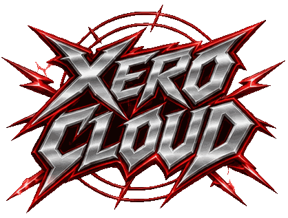

<h1 align="center">
  
</h1>

<p align="center">
  <a href="LICENSE"></a>
  <a href="#project-status"></a>
  <a href="docs/guides/getting-started.md">= 24" height="28"></a>
  <a href="docs/architecture/execution.md"></a>
  <a href="docs/integrations/aws/interoperability-matrix.md"></a>
  <a href="docs/architecture/runtime-compatibility.md"></a>
  <a href="docs/architecture/overview.md"></a>
</p>

**Give Xero a Lambda-style function. Xero runs it on your own hardware, next to your AWS account, and lets you choose per
invocation where it runs.**

> Your hardware. Your Lambdas. One cloud experience.

<p align="center">
  <a href="docs/architecture/overview.md">Architecture</a> ·
  <a href="docs/product/mvp.md">Product scope</a> ·
  <a href="docs/roadmap.md">Roadmap</a> ·
  <a href="CHANGELOG.md">Changelog</a> ·
  <a href="GOVERNANCE.md">Governance</a> ·
  <a href="CONTRIBUTING.md">Contributing</a> ·
  <a href="SECURITY.md">Security</a>
</p>

## What is Xero?

Xero is a free, open-source runtime for **AWS Lambda-style functions**. Point it at a folder with a Node.js or Python
handler. Xero packages it as an immutable artifact, runs it in an isolated, resource-limited container on your machine, and
gives you a CLI, an HTTP API and an SDK to deploy, invoke, inspect and remove it. Nothing needs an AWS account.

When you do want AWS, it is opt-in and explicit. The same *logical function* can also be bound to an **existing native AWS
Lambda**, and Xero will invoke either deployment, whichever you name, through the real `Invoke` API. Local handlers can call
real AWS services with the official SDK using short-lived credentials for a role you chose. An optional, outbound-only SQS
poller delivers messages from an existing queue to your local handler.

It is built for developers who want Lambda-style compute on hardware they already own (a laptop, a workstation, an
on-premises server) without giving up the AWS services and functions they already use, and for teams who want to see exactly
which deployment handled each request.

Xero runs on your own computer. There is no Xero account, no hosted service, no telemetry and nobody in the middle. It does
**not** implement S3, DynamoDB, SQS, IAM or any other AWS service, and it never creates AWS resources.

> **Status: v0.1, pre-release.** Local execution is verified on a real container engine; the AWS integration is verified
> with mocks only and has never talked to real AWS. Read [Project status](#project-status) before relying on it.

```
Your function ─► Package ─► Deploy (local) ─► Invoke ─┬─► local worker (container)
  (folder)       (immutable   (registry,      (you     └─► existing native AWS Lambda
                  artifact)    limits)         choose)
                                                          └─► logs · metrics · which deployment handled it · AWS cost counters
SQS queue (optional) ─► Xero poller (outbound only) ─► your handler ─► acknowledge / retry
```

## Contents

[Features](#features) · [Quick start](#quick-start) · [Ways to use Xero](#ways-to-use-xero) · [How it works](#how-it-works) ·
[What Xero can run](#what-xero-can-run) · [Safety](#safety) · [Project status](#project-status) ·
[The parts of the project](#the-parts-of-the-project) · [Use it as a library](#use-it-as-a-library) · [Develop](#develop) ·
[Contributing](#contributing) · [Documentation](#documentation) · [Governance](#governance-and-naming) · [License](#license)

## Features

- **Local-first execution.** Node.js (`nodejs20.x`, `nodejs22.x`) and Python (`python3.12`, `python3.13`) handlers run in
  containers built from the official AWS Lambda base images.
- **Real limits.** Per-function memory, timeout, concurrency, a global worker cap and a bounded wait queue. A timeout kills the
  container instead of just dropping the connection. Host exhaustion (`CAPACITY_EXHAUSTED`) is a different error from AWS
  throttling (`AWS_THROTTLED`).
- **Cold starts you can see.** Warm reuse, idle scale to zero (no workers running when idle), optional `minWarm`, and a
  cold/warm flag on every invocation.
- **One logical function, two targets.** A `local` and an `aws-lambda` deployment under one name, each with its own version,
  limits and identity. Explicit `--target` or a fixed default; no weights, no failover, no silent fallback.
- **AWS interoperability.** Connect a profile and region (verified read-only), call an existing Lambda, give local handlers
  temporary credentials for an existing role, and consume an existing SQS queue with at-least-once semantics.
- **Honest invocation records.** Every attempt records the logical function, deployment, target, request and attempt IDs,
  outcome and duration (never payloads). Unknown outcomes are reported, not guessed.
- **Operations built in.** Persistent registry, graceful shutdown, `xero doctor`, backup and restore, image pre-pull, scoped API
  tokens, rate limiting, structured and redacted logs, Prometheus-style metrics.
- **CLI, API and SDK on one engine.** The engine is the product; the interfaces are thin.

## Quick start

Requirements: **Node.js >= 24**, **pnpm 9**, and a Docker-compatible engine. On macOS use Docker Desktop, OrbStack or Colima
(`brew install colima && colima start --vm-type vz`; keep `XERO_HOME` under `$HOME`, see the
[guide](docs/guides/getting-started.md)).

```bash
pnpm install && pnpm build

# 1. Start the controller (listens on 127.0.0.1 only; state in ~/.xero)
node apps/controller/dist/main.js &

# 2. Deploy, invoke, inspect
xero() { node apps/cli/dist/main.js "$@"; }         # or `pnpm link --global` inside apps/cli
xero deploy ./examples/node-hello
xero invoke hello --payload '{"name":"Ada"}'
xero logs hello
xero functions inspect hello
xero doctor
```

The first invocation is a cold start and pulls the AWS Lambda base image (`xero images pull` does that ahead of time).
Later invocations reuse a warm worker until the idle TTL expires.

A function directory may carry a `xero.yaml` manifest (schema `xero.dev/v1alpha1`, **not frozen yet**); CLI flags override it:

```yaml
apiVersion: xero.dev/v1alpha1
kind: Function
metadata: { name: process-order }
spec:
  runtime: nodejs22.x          # nodejs20.x | nodejs22.x | python3.12 | python3.13
  handler: index.handler
  deployments:
    local: { memoryMb: 256, timeoutSec: 10, maxConcurrency: 2, idleTtlSec: 60, minWarm: 0 }
  routing: { strategy: manual, defaultTarget: local }
```

### Using AWS (optional)

Everything below is opt-in. Xero never creates Lambda functions, IAM roles, queues, stacks or network resources, and never
modifies triggers. Those must already exist, and you choose the identity Xero uses.

```bash
xero aws connect --profile development --region us-east-1   # read-only check: sts:GetCallerIdentity

# Bind an EXISTING Lambda as the aws-lambda deployment of the same logical function
xero functions bind hello --arn arn:aws:lambda:us-east-1:123456789012:function:hello:live

# One name, two independently addressable targets
xero invoke hello --target local      --payload '{"name":"Ada"}'
xero invoke hello --target aws-lambda --payload '{"name":"Ada"}'   # real Invoke API, billed by AWS
xero functions route hello --default-target aws-lambda             # static default, never automatic

# Outbound-only consumption of an existing SQS queue (at-least-once)
xero events attach hello --source sqs --queue-url <existing-queue-url>
```

See [`examples/hybrid-process-order`](examples/hybrid-process-order) and [`docs/integrations/aws/`](docs/integrations/aws) for
the required IAM and trust policies and the caveats.

## Ways to use Xero

| You want to… | Use |
|---|---|
| Work from a terminal | **`xero` CLI**: `deploy`, `invoke`, `logs`, `functions`, `aws`, `events`, `tokens`, `images`, `backup`, `doctor`, `metrics`, `status` |
| Call Xero from an app or script | **HTTP API** on `127.0.0.1:7777`: management and invocation are separate routes ([`api-sdk.md`](docs/architecture/api-sdk.md)) |
| Embed Xero in another tool | **TypeScript SDK**, [`@xero/sdk`](packages/sdk) (see [Use it as a library](#use-it-as-a-library)) |
| Keep it running | **User service** definitions for systemd and launchd in [`deploy/`](deploy) |
| Give an app limited access | **Scoped tokens**: `xero tokens create app --scope invoke` |
| Try it with a working function | The [`examples/`](examples) folder: Node.js, Python and a hybrid example |

## How it works

```
CLI / SDK / app / SQS poller ──► Controller (loopback) ──► Invocation router
                                                              │ chooses exactly one target
                                   ┌──────────────────────────┴───────────────────────────┐
                              local target                                       aws-lambda target
              scheduler ► warm pool ► container ► handler                  signed Invoke API ► native Lambda
                                   └──────────────────────────┬───────────────────────────┘
                                                      record · logs · metrics
```

1. **Authenticate** the caller, **resolve** the logical function, and pick the target: the one you asked for, else the
   function's fixed default. The routing decision is made *before* execution.
2. **Validate** the payload and the target's active deployment. A missing target is an error, never a fallback.
3. **Execute** on exactly one target. Local: reserve capacity, take a warm worker or cold-start one, run the handler with a
   deadline. AWS: call the real `Invoke` API with SDK retries disabled.
4. **Record** the attempt with correlation IDs and normalise results only where the semantics really match: a handler error is
   a function error, async invocation is "accepted", and a connection failure after dispatch is an unknown outcome.

Design rules that shape the code: the logical function is not an AWS ARN; the core packages never import the AWS SDK or Docker;
local-only functions keep working when AWS is unreachable; and Xero never replays a possibly completed non-idempotent
invocation. Details: [architecture overview](docs/architecture/overview.md),
[hybrid routing](docs/architecture/hybrid-routing.md) and the [ADRs](docs/adr).

## What Xero can run

| | Supported in v0.1 |
|---|---|
| Runtimes | `nodejs20.x`, `nodejs22.x`, `python3.12`, `python3.13` (official AWS Lambda base images) |
| Handlers | Lambda-style `exports.handler` / `lambda_handler(event, context)` taking JSON in and out, up to 6 MiB |
| Sources | A local folder (copied into an immutable, content-addressed artifact) |
| AWS targets | An **existing** Lambda (qualified ARN or alias) in an account/region you allow |
| Event sources | An **existing** SQS queue (outbound polling only) |

### What Xero is not

Compatibility claims are deliberately narrow:

- A local execution is **not** an AWS Lambda instance. The same logical function is two separate physical deployments that can
  differ in code, runtime, network, IAM identity, limits and cost.
- Xero **cannot** make a native Lambda ARN, alias or event-source mapping route to your machine, and cannot intercept
  `LambdaClient.Invoke(arn)` calls made by other code. Integration goes through a Xero API/SDK call, an explicit bridge, or the
  SQS adapter.
- Routing decides *per invocation*. A running invocation is never split or migrated.
- There is no support for Lambda layers, extensions, SnapStart or full Runtime API parity. The tested subset is in
  [`runtime-compatibility.md`](docs/architecture/runtime-compatibility.md).
- Not in v0.1 by design: creating or deploying native Lambdas, weighted routing, automatic failover, EventBridge / API Gateway /
  Step Functions ingress, multi-node scheduling. Each needs an [ADR or RFC](GOVERNANCE.md) first.

## Safety

Function artifacts are treated as **untrusted code**; standard containers are not a sufficient boundary for hostile
multitenant use, which is out of scope.

- **Containers.** Non-root, read-only root filesystem, all capabilities dropped, `no-new-privileges`, CPU/memory/pids limits,
  only the artifact mounted (read-only). No Docker socket, home directory or controller state is exposed to functions.
- **Local API.** Loopback only (other bind addresses are refused). Every route needs a bearer token; the master token lives in
  `$XERO_HOME/token` (0600). Scoped tokens (`read`, `invoke`, `admin`) are stored hashed and revocable. Host/Origin checks defend
  against DNS rebinding and browser requests; requests are rate limited.
- **AWS.** No AWS resource is ever created, no trigger modified, no traffic switched. Worker credentials are short-lived STS
  credentials for the role *you* named, never the controller's own. Account and region allow-lists restrict bindings and queues.
- **Data.** Credentials are never written to logs, artifacts or manifests; stored function logs are redacted. Invocation
  records contain metadata, never payloads.
- **Cost.** `xero metrics` exposes `aws_requests_total` per operation. Lambda, SQS and STS usage is billed by AWS; Xero is free.
- **Known limit.** Worker egress is **not** restricted by default; use engine-level network policy if you need that.

Threat model: [`docs/security/threat-model.md`](docs/security/threat-model.md). Report vulnerabilities privately, see
[`SECURITY.md`](SECURITY.md).

## Project status

| Area | Status |
|---|---|
| Local execution (Node.js, Python), warm reuse, scale to zero, limits, fencing on timeout | **Verified** on a real engine (Colima, Linux arm64, `nodejs22.x` and `python3.13`) by `pnpm test:e2e` |
| Registry persistence, CLI/API/SDK, tokens, backup/restore, graceful shutdown | **Verified** by unit and integration suites |
| AWS connect, role credentials, native Lambda `Invoke`, dual-target routing, SQS poller | Implemented and tested with SDK mocks and an in-memory SQS model. **Never run against real AWS.** The opt-in suite `tests/aws-disposable` exists for a disposable account |
| Other platforms (amd64, Podman), `nodejs20.x` / `python3.12` images, gVisor/Kata (`XERO_DOCKER_RUNTIME`) | Implemented, **not verified** |
| Production hardening | **Not yet.** No per-function network policy; local async (`Event`) invocations are in memory and lost on restart; no OpenTelemetry export |
| Weighted routing, failover, more AWS ingress, multi-node | Deferred by design |

Scope and acceptance criteria: [`docs/product/mvp.md`](docs/product/mvp.md) and
[`docs/architecture/acceptance-matrix.md`](docs/architecture/acceptance-matrix.md). Known gaps: [`CHANGELOG.md`](CHANGELOG.md).

## The parts of the project

| Part | What it is |
|---|---|
| [`apps/controller`](apps/controller) | The daemon: HTTP API, service layer and composition root |
| [`apps/cli`](apps/cli) | The `xero` command line, a thin layer over the SDK |
| [`packages/sdk`](packages/sdk) | Typed TypeScript client of the controller |
| [`packages/specification`](packages/specification) · [`core`](packages/core) | Schemas, domain model, structured errors and ports |
| [`packages/registry`](packages/registry) · [`artifacts`](packages/artifacts) | SQLite persistence with migrations; immutable artifact store |
| [`packages/invocation`](packages/invocation) · [`scheduler`](packages/scheduler) · [`scaling`](packages/scaling) | Router and target executors; concurrency admission; warm pool and scale to zero |
| [`packages/execution`](packages/execution) · [`executor-docker`](packages/executor-docker) · [`runtime-node`](packages/runtime-node) · [`runtime-python`](packages/runtime-python) | Execution port, Docker backend, runtime adapters |
| [`packages/aws-identity`](packages/aws-identity) · [`target-aws-lambda`](packages/target-aws-lambda) · [`event-source-sqs`](packages/event-source-sqs) | The only packages that use the AWS SDK |
| [`packages/telemetry`](packages/telemetry) · [`shared`](packages/shared) | Redacting logger and metrics; small shared utilities |
| [`examples/`](examples) · [`tests/`](tests) · [`docs/`](docs) · [`deploy/`](deploy) | Examples, test suites, documentation, service definitions |

## Use it as a library

The SDK is a small, typed client; it needs a running controller and does not depend on any hosted service. Packages are not
published yet (the project name is provisional), so use it from the workspace for now.

```ts
import { XeroClient } from '@xero/sdk';

const xero = await XeroClient.fromEnvironment();           // XERO_URL + XERO_TOKEN, or the token file in XERO_HOME

await xero.deployLocal('hello', { runtime: 'nodejs22.x', handler: 'index.handler', sourcePath: '/abs/path/to/fn' });

const result = await xero.invoke<{ message: string }>('hello', { name: 'Ada' }, { target: 'local' });
console.log(result.status, result.target, result.coldStart, result.payload);
```

Errors are `XeroApiError` with a stable `code` (for example `TARGET_NOT_DEPLOYED`, `CAPACITY_EXHAUSTED`, `UNKNOWN_OUTCOME`).
Give applications an `invoke`-scoped token rather than the master token.

## Develop

```bash
pnpm install
pnpm check                 # build + typecheck tests + lint + unit + contract + integration
                           # needs NO AWS credentials and no Docker daemon, and never incurs cloud charges
pnpm test:e2e              # needs a running Docker-compatible engine; skipped if none is reachable
pnpm test:aws-disposable   # OPT IN. Real AWS, disposable account only. See tests/aws-disposable/README.md
```

The default suites never use real AWS credentials. Never point the AWS suite at a production or shared account. The core
packages (`core`, `specification`, `invocation`, `scheduler`, `scaling`) must not import the AWS SDK, Docker or Kubernetes; lint
enforces it. Configuration is by environment variable (`XERO_HOME`, `XERO_PORT`, `XERO_MAX_WORKERS`, `XERO_QUEUE_LIMIT`,
`XERO_RATE_LIMIT_RPS`, `XERO_ALLOWED_ACCOUNTS`, `XERO_ALLOWED_REGIONS`, `XERO_DOCKER_RUNTIME`, `XERO_IMAGE_<RUNTIME>`); see the
[guide](docs/guides/getting-started.md).

## Contributing

Read [`CONTRIBUTING.md`](CONTRIBUTING.md), the [Code of Conduct](CODE_OF_CONDUCT.md) and [`CLAUDE.md`](CLAUDE.md) (project
principles and agent instructions; [`AGENTS.md`](AGENTS.md) summarises them). In short:

- Keep Xero **functions-only** and **local-first**; AWS interoperability stays opt-in but is a core contract.
- Behavioural changes need tests and docs; compatibility claims need evidence. Don't claim parity you haven't tested.
- Architectural decisions need an [ADR](docs/adr); backward-incompatible contracts and new AWS event integrations need an
  [RFC](docs/rfcs). Deferred features are not built without an approved change to `docs/product/mvp.md`.
- Commits follow Conventional Commits.

## Documentation

| | |
|---|---|
| **Start here** | [Getting started](docs/guides/getting-started.md) · [Examples](examples) |
| **Product** | [Vision](docs/product/vision.md) · [Principles](docs/product/principles.md) · [MVP scope](docs/product/mvp.md) · [Roadmap](docs/roadmap.md) |
| **Architecture** | [Overview](docs/architecture/overview.md) · [Function spec](docs/architecture/function-spec.md) · [Logical functions and deployments](docs/architecture/logical-functions-and-deployments.md) · [Hybrid routing](docs/architecture/hybrid-routing.md) · [Execution](docs/architecture/execution.md) · [Scheduling and scaling](docs/architecture/scheduling-scaling.md) · [Persistence](docs/architecture/persistence.md) · [API and SDK](docs/architecture/api-sdk.md) · [Runtime compatibility](docs/architecture/runtime-compatibility.md) |
| **AWS** | [Credentials and IAM](docs/integrations/aws/credentials-and-iam.md) · [Native Lambda invoke](docs/integrations/aws/native-lambda-invoke.md) · [AWS service access](docs/integrations/aws/aws-service-access.md) · [SQS event source](docs/integrations/aws/sqs-event-source.md) · [Inbound bridges](docs/integrations/aws/inbound-bridges.md) · [Interoperability matrix](docs/integrations/aws/interoperability-matrix.md) |
| **Security** | [Threat model](docs/security/threat-model.md) · [Security policy](SECURITY.md) |
| **Decisions** | [ADRs](docs/adr) · [RFCs](docs/rfcs) · [Governance](GOVERNANCE.md) · [Changelog](CHANGELOG.md) |

## Governance and naming

Xero is an independent Cloud Republic OSS project ([`GOVERNANCE.md`](GOVERNANCE.md)). Sponsorship is never a runtime
dependency, and the project works without any Cloud Republic, Hero or Zerverless service. Other products may integrate through
the documented API and SDK.

The name "Xero" is a **working name**: it clashes with an existing company and with an earlier infrastructure-as-prompt
product, so nothing is published to npm or other registries until a naming decision is made.

## License

Licensed under the [Apache License 2.0](LICENSE). Third-party production dependencies are Apache-2.0, MIT, ISC or 0BSD.
AWS and AWS Lambda are trademarks of Amazon.com, Inc.; this project is not affiliated with or endorsed by AWS.
